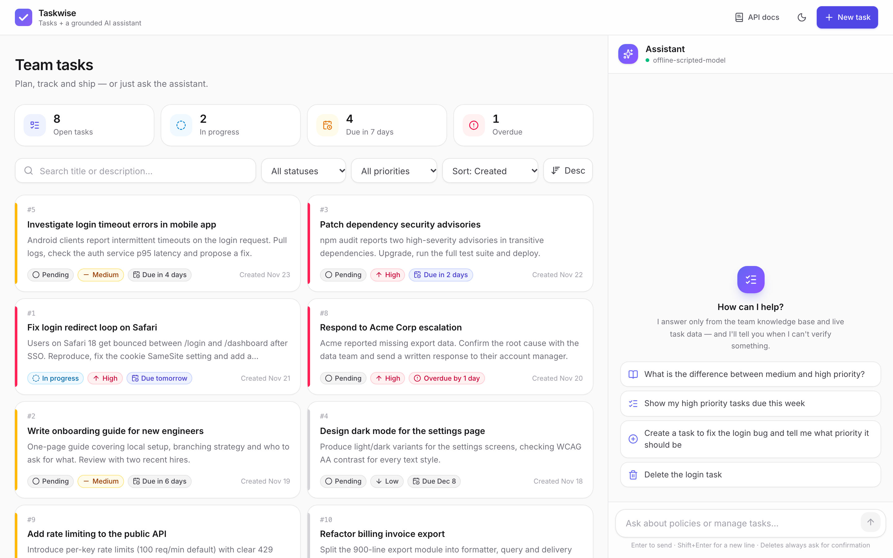

# Taskwise: task manager with a grounded AI assistant

A full-stack task manager (React + Express, in-memory) with an **agentic Claude assistant**. The assistant answers team-policy questions **only** from a local knowledge base and reads or changes tasks **only** through tools that reuse the REST API's service layer. It says clearly when it cannot verify something.



| | |
|---|---|
| **Part A: Full stack** | Dashboard (create, edit, view, delete), loading/empty/error states, responsive, REST API with validation and correct status codes, one centralized error handler |
| **Part B: Agentic AI** | KB retrieval with a calibrated threshold, 5 task tools on the shared service layer, routing `kb`/`tool`/`both`/`none`, evidence in every response, confirmation for deletes, idempotency, timeouts/retries/circuit breaker, streaming UI |
| **Part C: Design** | [`docs/design-note.md`](docs/design-note.md) |
| **Bonus** | Debounced search, filters, sorting, pagination, dark mode, OpenAPI/Swagger, 97 automated tests, streaming responses, eval script with PASS/FAIL |

---

## Contents
1. [Quick start](#1-quick-start)
2. [LLM provider and environment variables](#2-llm-provider-and-environment-variables)
3. [Architecture](#3-architecture)
4. [REST API](#4-rest-api)
5. [The assistant](#5-the-assistant)
6. [Retrieval and the relevance threshold](#6-retrieval-and-the-relevance-threshold)
7. [Testing and evaluation](#7-testing-and-evaluation)
8. [Assumptions and trade-offs](#8-assumptions-and-trade-offs)
9. [Project structure](#9-project-structure)

---

## 1. Quick start

**Prerequisites:** Node.js **≥ 20.19** (tested on 22.14) and npm 10.

```bash
git clone <this-repo> && cd <this-repo>
npm install                                  # installs backend + frontend (npm workspaces)
cp backend/.env.example backend/.env         # then set ANTHROPIC_API_KEY in backend/.env
npm run dev                                  # API on :4000, web app on :5173
```

Open **http://localhost:5173**. API docs (Swagger UI) are at **http://localhost:4000/api/docs**.

| Command (repo root) | What it does |
|---|---|
| `npm run dev` | Backend (`tsx watch`) and frontend (Vite) together |
| `npm test` | All automated tests (backend 89, frontend 8). No network or API key needed |
| `npm run typecheck` | Strict TypeScript across both apps |
| `npm run build` then `npm start` | Production build: compiled API + `vite preview` |
| `npm run eval` | Runs the 8 required assistant cases against the **real** LLM and prints PASS/FAIL |
| `npm run kb:calibrate -w backend` | Prints retrieval scores and the threshold sweep (section 6) |

Run the apps separately if you prefer: `npm run dev -w backend` and `npm run dev -w frontend`.

**Without an API key** the dashboard works normally, and the assistant replies with a clear "not configured" message (HTTP 503).

## 2. LLM provider and environment variables

**Provider:** Anthropic Claude via the official `@anthropic-ai/sdk`. The default model is **`claude-haiku-5-5`**, the cheapest current Claude model ($0.10 / $0.50 per million input/output tokens), run at `effort: low`.

This workload is routing plus tool calling over a small context, which a small model handles well, and low effort keeps latency down. To change the model, set `ANTHROPIC_MODEL=claude-sonnet-5-5` (or `claude-opus-5-5`). No code changes are needed.

Set the key in **`backend/.env`**. A repo-root `.env` also works as a fallback. Real environment variables always take precedence. `.env` files are git-ignored, and only `.env.example` files are committed.

| Variable | Default | Purpose |
|---|---|---|
| `ANTHROPIC_API_KEY` | (empty) | Claude API key. The assistant is disabled (503) without it. |
| `ANTHROPIC_MODEL` | `claude-haiku-5-5` | Model id |
| `LLM_EFFORT` | `low` | Thinking effort (`low` / `medium` / `high`) |
| `LLM_MAX_TOKENS` | `2048` | Max output tokens per LLM call |
| `LLM_TIMEOUT_MS` | `12000` | Timeout per LLM call |
| `LLM_MAX_RETRIES` | `1` | Retries per LLM call (timeouts / 429 / 5xx only, jittered backoff). **Writes are never retried.** |
| `ASSISTANT_DEADLINE_MS` | `30000` | Total time budget per assistant request |
| `ASSISTANT_MAX_STEPS` | `6` | Max model↔tool round-trips per message |
| `ASSISTANT_RATE_LIMIT_PER_MIN` | `30` | Per-client rate limit on assistant endpoints (cost protection) |
| `CIRCUIT_FAILURE_THRESHOLD` / `CIRCUIT_COOLDOWN_MS` | `3` / `30000` | Circuit breaker: fail fast while the LLM is down |
| `KB_RELEVANCE_THRESHOLD` | `0.18` | Minimum cosine similarity for a KB passage to count as evidence (section 6) |
| `KB_RELATIVE_CUTOFF` | `0.5` | Also drop passages scoring below 50% of the best passage |
| `KB_TOP_K` | `3` | Max passages returned per search |
| `FORCE_TOOL_FAILURE` | `false` | Simulate an outage of every task tool (test case 6) |
| `IDEMPOTENCY_TTL_MS` | `86400000` | How long idempotency keys are remembered |
| `PENDING_ACTION_TTL_MS` | `300000` | How long a delete confirmation stays valid |
| `PORT`, `CORS_ORIGIN`, `LOG_LEVEL`, `SEED_DATA` | `4000`, `http://localhost:5173,…`, `info`, `true` | Server basics. `SEED_DATA` loads 10 demo tasks with dates relative to today. |

Frontend (`frontend/.env`, optional): `VITE_API_URL` (empty means use the Vite proxy) and `API_PROXY_TARGET` (default `http://localhost:4000`).

> **Simulated tool failure without a restart:** outside production, send `X-Simulate-Tool-Failure: true` on an assistant request. This is equivalent to `FORCE_TOOL_FAILURE=true` for that one request.

## 3. Architecture

```mermaid
flowchart LR
    subgraph Web[frontend - React]
      UI[Dashboard + Assistant panel] --> API[api/ layer: fetch wrapper,<br/>Idempotency-Key, SSE parser]
    end
    API -->|REST /api/tasks| TR[routes → controllers]
    API -->|/api/assistant/chat(/stream)| AR[assistant routes<br/>rate limit, idempotency]
    TR --> S[TaskService<br/>validation + business rules]
    AR --> AG[AssistantAgent<br/>tool loop, guards, grounding]
    AG -->|tools| S
    AG -->|search_knowledge_base| KB[TF-IDF retriever<br/>knowledge-base/*.md]
    AG -->|Messages API| C[(Claude)]
    S --> R[(In-memory repository)]
```

**Key decisions**
- **One business layer.** `TaskService` validates its own `unknown` input with Zod. The REST controllers and the assistant tools both call it, so a tool can't bypass a rule the API enforces. Tool JSON schemas are generated from the same Zod schemas (`z.toJSONSchema`), so the contract can't drift.
- **Layering:** `routes → controllers → services → repository`. Controllers only translate HTTP. The repository is an interface with an in-memory adapter. Express 5 forwards async errors to **one** error handler, which produces one envelope: `{ error: { code, message, details?, requestId } }`.
- **Composition root** (`container.ts`) wires everything. Tests build an isolated container per test with a fixed clock and a scripted fake LLM.
- **Frontend:** all HTTP lives in `src/api/`. Server state is managed with TanStack Query. After any write, from the dashboard or the assistant, the `tasks` query key is invalidated, so every view refreshes without a page reload.

## 4. REST API

Full spec: **Swagger UI at `/api/docs`** (`backend/openapi.yaml`, also served as `/api/openapi.json`).

| Method | Endpoint | Purpose | Status codes |
|---|---|---|---|
| GET | `/api/tasks` | List tasks. `status`, `priority` (comma-separated allowed), `q`, `createdBy`, `dueBefore`/`dueAfter`, `sortBy`, `order`, `page`, `limit` | 200 / 400 |
| GET | `/api/tasks/:id` | Get one task | 200 / 400 (malformed id) / 404 |
| POST | `/api/tasks` | Create. Optional `Idempotency-Key` header | 201 / 400 / 422 (key reused with a different body) |
| PUT | `/api/tasks/:id` | Partial update (at least one known field) | 200 / 400 / 404 |
| DELETE | `/api/tasks/:id` | Delete | 200 / 404 |
| POST | `/api/assistant/chat` | Assistant (JSON) | 200 / 400 / 409 / 422 / 429 / 503 |
| POST | `/api/assistant/chat/stream` | Assistant (Server-Sent Events) | 200 stream |
| GET | `/api/health`, `/api/metrics` | Liveness and assistant status; counters and latency percentiles | 200 |

**Validation rules** (shared by the API, the tools and the web form):
- Title: 3–120 characters.
- Description: required, at most 2000 characters.
- Enums are checked for status and priority.
- `dueDate` must be a real `YYYY-MM-DD` calendar date, and **not in the past on create** (this matches the KB policy).
- **Unknown fields are rejected** rather than silently dropped.
- `createdBy`, ids and timestamps are always set by the server.

## 5. The assistant

### Request and response
```jsonc
// POST /api/assistant/chat
{ "message": "Create a task to fix the login bug and tell me what priority it should be",
  "confirm": false, "pendingActionId": null, "conversationId": null }
```
```jsonc
{
  "answer": "Created #11 \"Fix login bug\" as high priority — a bug that prevents users from logging in blocks them [priority-levels#high-priority].",
  "route": "both",                                       // kb | tool | both | none, computed from what actually ran
  "evidence": [{ "id": "priority-levels#high-priority", "title": "Priority levels", "section": "High priority",
                 "score": 0.41, "snippet": "…" }],
  "toolCalls": [{ "name": "create_task", "arguments": { … }, "status": "success", "result": { "created": { … } } }],
  "needsConfirmation": null,                            // set when a delete awaits confirmation
  "conversationId": "…",
  "meta": { "requestId": "…", "model": "claude-haiku-5-5", "latencyMs": 2140, "llmCalls": 3,
            "usage": { … }, "retrieval": [ /* every search: passed + rejected scores */ ],
            "groundingWarnings": [], "degraded": false, "tasksChanged": true }
}
```
Real request/response pairs for all 8 required cases are in **[`docs/sample-requests.md`](docs/sample-requests.md)**. That file is generated by `npm run eval -- --write-docs`, so it can't drift from real behaviour.

### How it decides: retrieval, tools, both or neither
The model routes by **choosing tools**: `search_knowledge_base` for policy, the task tools for data, both, or none. The system prompt (`assistant/prompts.ts`) sets the rules. The **server** then computes `route` from what actually happened, rather than trusting the model's own description:
- `kb` means passages above the threshold ground the answer.
- `tool` means a task tool ran.
- `both` means both of the above.
- `none` means neither, for example an out-of-scope question or retrieval below the threshold.

This saves the extra LLM round-trip a separate router call would cost (see the design note).

### Tools (all call `TaskService`)
| Tool | Kind | Notes |
|---|---|---|
| `search_knowledge_base(query)` | read | Returns only passages above the threshold, each with a citation id. An empty result tells the model to say it can't verify. |
| `list_tasks(status?, priority?, dueBefore?, q?)` | read | Sorted by due date. `dueBefore` is inclusive. |
| `get_task(id)` | read | Returns a `TASK_NOT_FOUND` error result if the task is missing. |
| `create_task(title, description, priority?, dueDate?, status?)` | write | Same schema as `POST /api/tasks`. Sets `createdBy: "assistant"`. |
| `update_task(id, fields)` | write | `fields` is the strict update schema, so unknown fields are rejected. |
| `delete_task(id)` | destructive | **Never deletes.** It parks a single-use pending action and returns `needsConfirmation`. |

### Grounding and hallucination control
1. **Prompt contract:** two sources of truth only; every policy claim must cite a passage id; "I couldn't verify that…" when nothing relevant comes back.
2. **Threshold:** weak passages never reach the model (section 6).
3. **Post-generation checks** (`assistant/grounding.ts`): citations to passages not retrieved in this turn are **stripped and flagged**. Task ids in the answer that no tool returned are **flagged**. Warnings appear in `meta.groundingWarnings`, in the UI, in the logs and in the metrics.
4. **Honest failures:** tool errors return as `ok:false` with a code. If the LLM fails *after* a write, the answer is built **deterministically from the audit trail**, so the user always learns what actually happened.

### Edge cases
| Case | Behaviour | Where |
|---|---|---|
| Empty input | `400 EMPTY_MESSAGE` with no LLM call. The UI also disables Send. | `agent.ts`, `ChatInput.tsx` |
| Unknown or missing id | Tool returns `TASK_NOT_FOUND` and the model asks for a valid id. With no id at all, the model asks which task. | `executor.ts`, prompt |
| Ambiguous reference ("delete the login task") | The model lists both matches with ids and asks. Nothing is parked. Follow-ups work through short server-side memory. | prompt, `conversationStore.ts` |
| Invalid tool arguments | `INVALID_ARGUMENTS` with field details from the REST schemas | `executor.ts` |
| LLM timeout or error | 12s per-call timeout, 1 jittered retry, 30s deadline, circuit breaker. Honest 503 if nothing changed; 200 `degraded` if a write had committed. | `resilience.ts`, `agent.ts` |
| Simulated tool failure | `FORCE_TOOL_FAILURE=true`, or the dev-only header. The tool returns `TOOL_UNAVAILABLE` and the model reports it. Nothing changes. | `executor.ts` |
| Destructive action | A pending action (5-min TTL, single-use, bound to the task's `updatedAt`) is executed by a second request with `confirm: true`, **without the LLM** | `pendingActions.ts`, `agent.ts` |
| Duplicate request | An `Idempotency-Key` replays the first response, and concurrent duplicates share one execution. Identical writes repeated by the model within one turn run once. | `idempotency.ts`, `executor.ts` |

### UI integration
- The chat panel streams progress: "Searched knowledge base… 2 passages above threshold", "Create task ✓".
- Answers render with numbered citation chips, and `#id` references open the task drawer.
- Evidence chips show the document › section, a score bar and a snippet.
- Tool calls can be expanded to show arguments and the result or error.
- A Confirm/Cancel card counts down to expiry.
- A safe **Retry** after network errors reuses the same idempotency key.
- When the assistant creates, updates or deletes a task, the task list refreshes and highlights the change, without a page reload.

## 6. Retrieval and the relevance threshold

**How it works** (`assistant/knowledge/`):
- Seven markdown policy docs live in `backend/knowledge-base/`. Each `##` section becomes one chunk, giving **25 chunks** with stable citation ids such as `priority-levels#medium-versus-high`.
- The text pipeline is: lowercase → tokens → stopwords → Porter stemming → synonym **canonicalisation** on both sides (urgent→high, deadline→due, remove→delete…).
- Scoring is **TF-IDF cosine similarity** with sublinear TF and smoothed IDF. The section title is weighted above body text.
- Filters, in order: absolute threshold **0.18**, then a relative cutoff (≥ 50% of the top score), then **top-k = 3**.

**Why TF-IDF cosine rather than BM25 or embeddings.** Cosine scores are bounded in [0, 1], so a single threshold means the same thing for short and long queries. Raw BM25 scores are unbounded and grow with query length, which makes a fixed threshold brittle. The approach also needs no infrastructure, is deterministic, and every score can be explained by hand. The KB is small and its vocabulary is controlled, so lexical matching with synonym canonicalisation is enough. Embeddings plus a re-ranker would be the upgrade for paraphrase-heavy questions.

**One important detail: out-of-vocabulary penalty.** Query words the KB has never seen still count toward the query vector's length, weighted as maximally rare. Without this, "What is our *refund* policy?" collapses to just "policy" and matches the deletion policy confidently. With it, unknown topics score low, which is exactly the signal behind "I can't verify that".

### How the threshold was chosen
`npm run kb:calibrate -w backend` scores a **labelled set of 30 queries**: 16 the KB answers, each tagged with the document that should answer it, and 14 it does not. It then sweeps candidate thresholds. Example scores:

| Query | Top chunk | Score | Should pass? |
|---|---|---|---|
| Is deleting a task permanent? | deletion-policy#deletion-is-permanent | **0.753** | ✅ |
| When does weekly triage happen? | weekly-triage#when-triage-happens | **0.624** | ✅ |
| What is the difference between medium and high priority? | priority-levels#medium-versus-high | **0.547** | ✅ |
| What does medium priority mean here? | priority-levels#medium-priority | **0.488** | ✅ |
| What makes a good description? | writing-good-tasks#good-descriptions | **0.303** | ✅ |
| When is a task considered overdue? | due-dates-and-overdue#when-a-task-is-overdue | **0.290** | ✅ |
| What priority should a bug that blocks login get? | priority-levels#high-priority | **0.209** ← lowest in-scope | ✅ |
| What is the dress code? | status-lifecycle#completed | **0.152** ← highest out-of-scope | ❌ |
| What is the remote work policy? | deletion-policy#when-to-delete | 0.137 | ❌ |
| What is the weather in Delhi? | assistant-guide#what-the-assistant-will-not-do | 0.128 | ❌ |
| What is our refund policy? | assistant-guide#what-the-assistant-will-not-do | 0.085 | ❌ |
| How do I reset my password? | (no overlap) | 0.000 | ❌ |

| Threshold | In-scope recall (correct doc) | Out-of-scope rejection | Accuracy |
|---|---|---|---|
| 0.125 | 100% | 71% | 87% |
| 0.150 | 100% | 93% | 97% |
| **0.175–0.200** | **100%** | **100%** | **100%** |
| 0.225 | 88% | 100% | 93% |
| 0.300 | 75% | 100% | 87% |

The lowest in-scope score is **0.209** and the highest out-of-scope score is **0.152**. I picked the **midpoint, 0.18**, which maximises the margin on both sides (about 0.03 each way).

Why not lean higher? A false *accept* (answering from weak context) is worse than a false *reject*. But 0.20 would sit right on the lowest legitimate query, and there is a second line of defence: the prompt requires the model to answer only if the passage actually answers the question.

Calibration also surfaced a bug worth fixing. A `start→progress` synonym made "How many tasks can I have **in progress**?" rank the *Pending* section first. Removing it widened the margin from 0.034 to 0.057.

The labelled set is also a **regression test** (`tests/retrieval.test.ts`): editing the KB or tokenizer in a way that breaks separation fails CI. In production, the distribution of `kb_top_score` near the threshold is monitored (design note, section 6).

## 7. Testing and evaluation

- **Backend, 89 tests (Vitest + Supertest), offline.** They cover the REST contract (status codes, validation, filters, pagination, idempotency including concurrent double-submits), retrieval (calibration regression, OOV penalty, cutoffs) and resilience (retry/backoff, deadline, circuit breaker half-open).
  - The **agent tests** drive the full loop with a **scripted fake LLM** that sees the real requests, including tool results. They cover all 8 required cases plus stale confirmations, timeouts, failure-after-write, grounding violations, conversation memory and SSE streaming.
- **Frontend, 8 tests (Vitest + Testing Library):** form validation and server errors, safe answer rendering (no HTML injection, citation chips, task links), and the SSE frame parser.
- **Real-model eval:** `npm run eval` boots the app with fresh seed data, sends each required case over HTTP to the real model, and checks the route, tool calls, evidence, state changes and that no task ids were invented. Any 5xx fails a case, so an outage can't pass as a correct answer. `--runs N` measures stability; `--write-docs` regenerates `docs/sample-requests.md`.
- **Manual checks:** `docs/sample-requests.md` has curl commands for every case.

## 8. Assumptions and trade-offs

**Assumptions**
- Single-user, single team. "My tasks" means all tasks, because there is no auth or ownership in scope.
- Due dates are calendar dates (`YYYY-MM-DD`) in server-local time, not timestamps. That avoids "due today shows as overdue" timezone bugs.
- Creating a task with a past due date is rejected, matching the KB policy. Editing a task may keep a past date, since a task can become overdue.
- Malformed ids (`/api/tasks/abc`) return **400** rather than 404: it's a bad request, not a missing resource.

**Trade-offs**
- **State is in memory and per process**: tasks, idempotency keys, pending actions, conversations and metrics, as the brief requires. A restart clears everything. Running several instances would need Redis or Postgres behind the same interfaces, or duplicate protection only holds per process.
- **Agentic routing (tool choice) instead of a separate classifier call:** one fewer LLM round-trip, with the route still computed deterministically on the server. The cost is less direct control. For example, the model *may* search the KB on a plain task query; the route then reflects that honestly.
- **Lexical retrieval** is precise, explainable and free, but weaker on paraphrases that share no vocabulary with the KB. Embeddings would be the next step.
- **Conversation memory** stores only text turns, not tool results, so the model must re-fetch task facts each turn. That costs a little latency in exchange for never relying on stale data.
- **Stats cards** compute from one `limit=100` query. That's fine for an in-memory demo; a real system would add an aggregate endpoint.

**Not done / next steps**
- Authentication and per-user ownership ("my tasks").
- Persistent storage and distributed idempotency (Redis `SET NX`).
- A cross-encoder re-ranker for retrieval.
- Playwright end-to-end tests in CI. The screenshot script exists, but it isn't asserted in CI.
- User feedback (👍/👎) on answers, to feed the eval set.

## 9. Project structure

```
backend/
  knowledge-base/*.md            7 policy documents (the assistant's only policy source)
  openapi.yaml                   API spec → Swagger UI at /api/docs
  scripts/eval.ts                real-model evaluation (8 required cases, PASS/FAIL)
  scripts/calibrate-threshold.ts retrieval score report + threshold sweep
  src/
    app.ts, server.ts, container.ts
    config/env.ts                validated env (fails fast at boot)
    routes/ controllers/ services/ repositories/ schemas/ middleware/ lib/
    assistant/
      agent.ts                   orchestrator: loop, guards, route, degraded answers
      prompts.ts                 system instruction
      tools/definitions.ts       tool specs from the shared Zod schemas
      tools/executor.ts          validation, failure injection, dedupe, confirmations
      knowledge/                 loader, tokenizer, TF-IDF retriever
      llm/                       Claude client, retries/backoff, circuit breaker
      grounding.ts, pendingActions.ts, conversationStore.ts
  tests/                         89 tests (REST, retrieval, agent, resilience)
frontend/
  src/api/                       the only place that talks HTTP
  src/hooks/                     useTasks (TanStack Query), useAssistant (chat state machine)
  src/components/ui/             Button, Badge, Modal, Drawer, Field, EmptyState, ErrorBanner…
  src/components/tasks/          TaskCard, TaskForm, TaskModal, TaskDetailsDrawer, TaskList…
  src/components/assistant/      AssistantPanel, ChatMessage, EvidenceList, ToolCallList, ConfirmationCard…
docs/
  design-note.md                 Part C
  sample-requests.md             real requests/responses for the 8 cases
  screenshots/                   UI screenshots (+ demo video)
```
