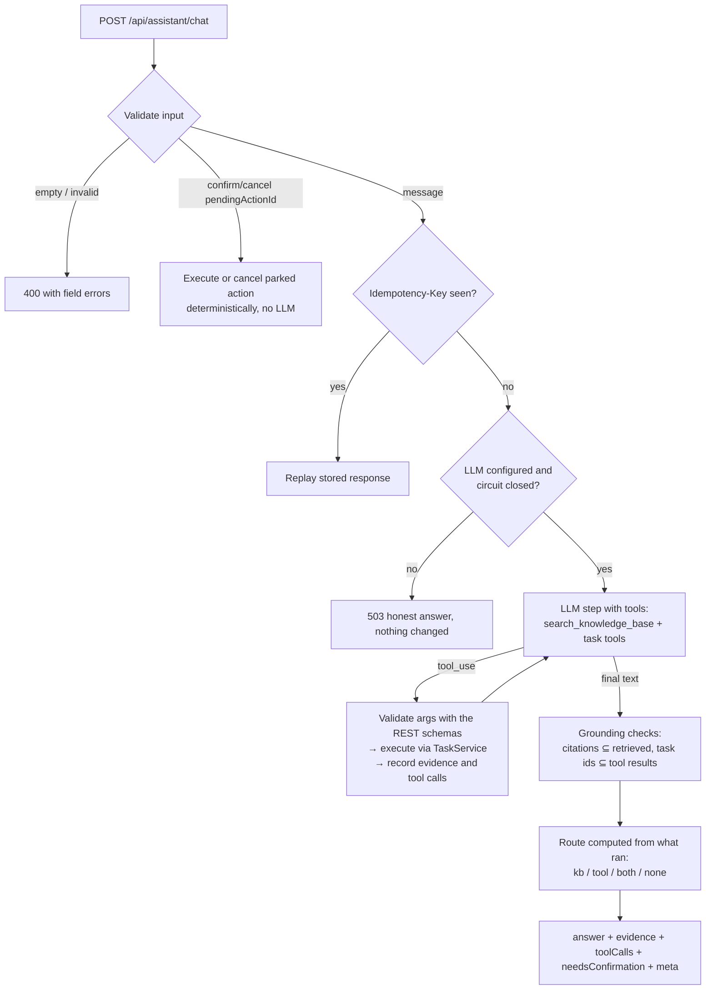

# Design note: debugging and redesigning the assistant workflow (Part C)

**Original flow:** `User → LLM → Search knowledge base → LLM → Task API (if needed) → LLM → Response`
**Reported symptoms:** wrong answers, duplicate tasks, and a very slow assistant when the LLM or an external service is down.

Section 2 is what `backend/src/assistant/agent.ts` actually does. Section 8 lists where the implementation differs from a production deployment.

---

## 1. Technical problems in the original workflow

| # | Problem | Symptom it causes |
|---|---|---|
| 1 | **Retrieval is unconditional.** Every message searches the KB, even "show my tasks". Irrelevant policy text is stuffed into the prompt. | Wrong answers. Wasted latency. |
| 2 | **No relevance threshold and no grounding contract.** Whatever the search returns is treated as truth. Nothing forces citations, and nothing checks them. | Hallucinated or blended policy. No way to audit why an answer was given. |
| 3 | **Writes sit inside a chain that is retried as a whole.** A client retry, a gateway retry or an LLM-step retry replays the Task API call. There is no idempotency key and no record that the write already happened. | Duplicate tasks. |
| 4 | **Three sequential LLM calls on the critical path, with no timeouts, deadline or circuit breaker.** Each hop waits on the default (multi-minute) HTTP timeout. | Very slow, or hanging, when the LLM or an API is down. Every user pays the full timeout. |
| 5 | **LLM output goes straight to the Task API with no validation.** Ids, enums and unknown fields are not checked, and the model can invent ids. | 4xx/5xx from the API, or silently wrong updates. |
| 6 | **No confirmation step for destructive actions.** The model can delete directly. | Data loss on a misunderstood request. |
| 7 | **The final LLM call re-narrates tool results.** Errors can be paraphrased away ("I've created the task" after a 500), and the response carries no structured evidence. | Confident but false answers. |
| 8 | **No per-step observability.** There is no request id, route, scores, tool status or timing per hop. | Nobody can tell which hop produced a wrong answer or the latency. |

## 2. Redesigned workflow: decide first, then act



1. **Validate.** Reject empty or malformed input with a 400 before spending tokens.
2. **Short-circuit deterministic paths.** Confirm/cancel of a parked delete runs in code, without the LLM. Replayed idempotency keys return the stored response.
3. **Fail fast.** If the LLM isn't configured or the circuit breaker is open, return an honest 503 immediately. The dashboard keeps working.
4. **The model decides the route by choosing tools.** It picks between `search_knowledge_base`, the task tools, both, or neither. Retrieval only happens when the question needs policy.
5. **Every tool call goes through guards.** Arguments are validated with the same Zod schemas as the REST API. Execution goes through the same `TaskService`. Errors return as structured `ok:false` results. `delete_task` only parks a pending action. Identical writes within a turn are de-duplicated.
6. **Resilience wraps LLM calls, never writes.** Each call has its own timeout, retries use jittered backoff, and the whole request has a deadline.
7. **Post-checks.** Citations must refer to passages retrieved in this turn, and task ids must have come from tool results. Violations are stripped and flagged.
8. **The route is computed by the server, not self-reported by the model.** `kb` if retrieved passages ground the answer, `tool` if task tools ran, `both`, or `none`.
9. **The response carries its evidence:** passages with scores and snippets, every tool call with its arguments and result or error, the pending confirmation, and metadata (latency, tokens, retrieval trace, warnings).

## 3. Preventing duplicate execution: idempotency keys and state

The client generates an `Idempotency-Key` for each *logical* request: once per create dialog, and once per chat send. It **reuses** that key on retry. The server stores one record per `(method + path, key)`:

```
absent ──(first request)──▶ IN_FLIGHT{fingerprint, promise} ──(<500)──▶ COMPLETED{fingerprint, status, body}  (TTL 24h)
                                     └──(throw / 5xx)──▶ deleted (safe: nothing was committed)
```

- **Same key and same body while IN_FLIGHT** (double click): the second request awaits the *same promise*, so the work runs once. The check-and-set is synchronous, which makes it race-free on Node's single thread. In a multi-instance setup this becomes Redis `SET key NX PX` plus a unique constraint on the key in the database.
- **Same key and same body after completion** (client retry): the stored response is replayed byte-for-byte with `Idempotent-Replayed: true`.
- **Same key with a different body:** `422 IDEMPOTENCY_KEY_REUSED`. This is a client bug, not a retry.
- **Inside a turn,** the executor remembers `(tool, args)` for writes. If the model emits the same `create_task` twice, it runs once.
- **Destructive actions are a second state machine.** `PENDING → (take) → EXECUTED | CANCELLED | EXPIRED`. `take()` removes the record atomically, so a confirmation is single-use. It is also bound to the task's `updatedAt`, so a task that changed after the proposal is not deleted.

## 4. Retrieval returns three documents and only one is relevant

Defence in depth, all implemented:

1. **Absolute threshold (0.18 cosine).** Calibrated on 30 labelled queries (README → *Relevance threshold*). Weak passages never reach the model.
2. **Relative cutoff.** Passages scoring below 50% of the top score are dropped even if they clear the threshold, which removes the "also-ran" documents.
3. **Section-level chunks and top-k = 3.** The model sees short, focused passages instead of whole documents.
4. **Mandatory citations, validated.** The prompt requires every policy claim to cite a passage id. The server strips citations to anything not retrieved in this turn, and `evidence` lists only the passages the answer actually cited.
5. **Instruction to ignore passages that don't answer the question,** and to say "I couldn't verify that" instead of stretching weak context.
6. *(Production next step)* A cross-encoder re-ranker, or LLM relevance grading of each passage, before generation.

## 5. Timeouts, retries, backoff and fallbacks

| Layer | Setting (env) | Why |
|---|---|---|
| Per LLM call | 12s timeout (`LLM_TIMEOUT_MS`) via `AbortController` | An 8–10s response still succeeds; a hung call is cut. |
| Retries | 1 retry (`LLM_MAX_RETRIES`), exponential backoff with full jitter, **only** for timeout / 429 / 5xx / connection errors | Absorbs transient blips. Jitter avoids synchronized retry storms. 400/401 are never retried. |
| Whole request | 30s deadline (`ASSISTANT_DEADLINE_MS`). A retry starts only if it can finish in time. | Bounded worst case: the user never waits on stacked timeouts. |
| Circuit breaker | Opens after 3 consecutive availability failures, for 30s, then half-opens for one trial call | While the LLM is down, requests fail in ~1 ms instead of 12–30s. |
| Fallbacks | (a) If a write already committed, answer **deterministically from the audit trail** (HTTP 200, `degraded: true`). (b) Otherwise return an honest 503 saying "no tasks were changed". (c) The dashboard has no dependency on the LLM. | Users always know the true state. |
| UX | SSE streaming of progress (searches, tool calls, text) | Slow responses feel alive. |

**Why retries must not repeat a write:** a timeout is an *ambiguous* outcome. The write may have committed even though the response never arrived. Blindly re-running it causes exactly the duplicate-task bug. So retries wrap **only the LLM call**, which has no side effects. Tool executions happen outside the retry loop, exactly once per `tool_use` id. Client-level retries are made safe by the idempotency key, which replays the first result instead of re-executing.

## 6. What to log and monitor

Every turn emits one structured log line (`assistant turn`) with: `requestId`, `conversationId`, route, HTTP status, latency, LLM calls, token usage, each tool as `name:status`, each retrieval query with its top score and number of passages passed, grounding warnings, and the degraded flag. `GET /api/metrics` exposes the same as counters and percentiles.

| Concern | Signals → alerts |
|---|---|
| **Hallucination** | `assistant_grounding_warnings_total` (stripped citations, unknown task ids) as a rate per turn. Policy answers with no evidence (`route=none` while the answer asserts policy). Sampled transcript review. User thumbs-down. |
| **Poor retrieval** | `kb_searches_no_result` rate. Distribution of `kb_top_score`, with drift toward the threshold meaning the KB or queries changed. Queries that land within ±0.03 of the threshold go to a labelling queue. The offline calibration set runs in CI (`retrieval.test.ts`). |
| **Tool failures** | `tool_<name>_error` by error code (`TASK_NOT_FOUND` is user error; `TOOL_UNAVAILABLE` / `TOOL_ERROR` page someone). `tool_duplicate_writes_blocked`. Confirmations requested vs confirmed. |
| **Slow requests** | p50/p95/max of `assistant_latency_ms` and `http_latency_ms`. `llm_retries`. `llm_failures_<kind>`. Circuit-breaker state (shown in `/api/health`). Tokens per turn, for cost. |
| **Regression** | `npm run eval` against the real model before each prompt or model change, tracking the pass rate over `--runs N`. |

## 7. System instruction

This is the core of `SYSTEM_PROMPT` in `backend/src/assistant/prompts.ts`:

> You are the task assistant for this team. You have exactly two sources of truth: the team knowledge base, reachable only through `search_knowledge_base`, and live task data, reachable only through the task tools. Never use general knowledge, assumptions or earlier messages as a source for policies or task facts.
> Every policy statement must come from a `search_knowledge_base` result and be cited with its citation id in square brackets. If the search returns nothing, or the passages don't actually answer the question, say "I couldn't verify that in the team's knowledge base" — do not fill the gap. Task facts (ids, titles, statuses, dates) must come from tool results in this turn; never invent them. If a tool returns `ok:false`, tell the user plainly what failed and never claim an action happened unless its result says `ok:true`. If a request is ambiguous or missing an id, ask instead of guessing; `delete_task` only requests confirmation — never say a task was deleted.

## 8. Where the implementation deliberately differs

- **One agentic loop instead of a separate router call.** Routing is the model's tool choice. That saves one LLM round-trip per message. The server still computes the `route` deterministically from what ran, so it stays auditable.
- **In-memory stores** for idempotency, pending actions, conversations and metrics, because the brief forbids a database. The interfaces are shaped for Redis/Postgres. With multiple instances they must move there, or duplicate protection only holds per process.
- **Lexical retrieval** (TF-IDF with an out-of-vocabulary penalty) instead of embeddings. It's explainable and deterministic for a 25-chunk KB. Embeddings plus a re-ranker would be the next step for paraphrase-heavy queries.
